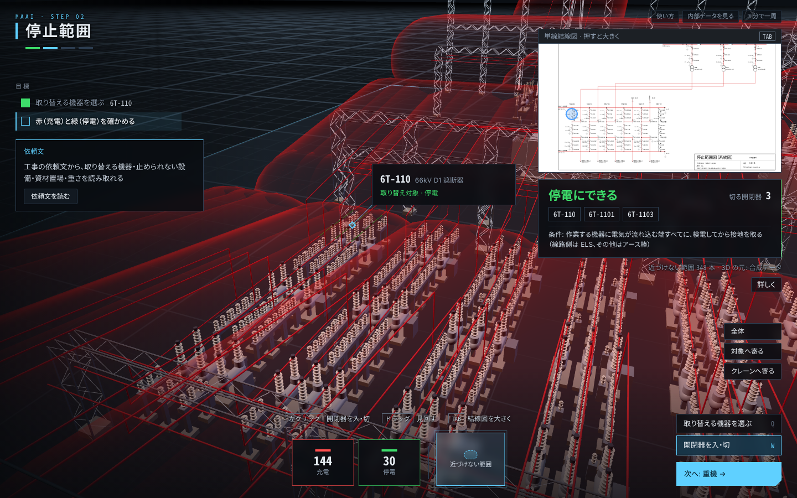
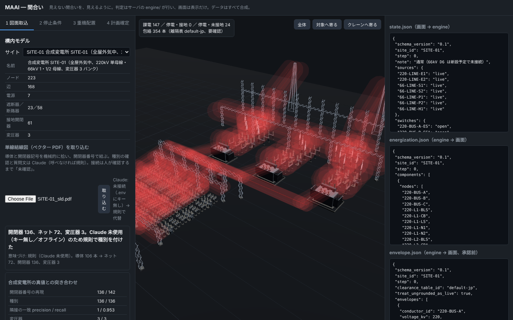
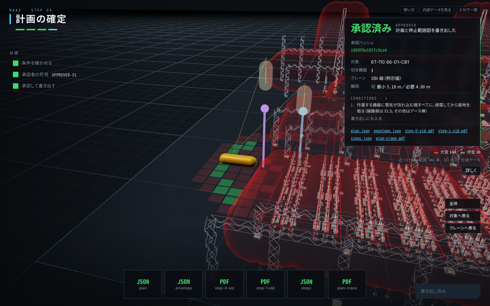

# MAAI（間合い）— Minimum Approach Area Indicator

[](https://github.com/Daxion1578/Minimum-Approach-Area-Indicator/actions/workflows/check.yml)

**見えない間合いを、見えるように。**

変電所の機器を取り替える作業日に、どこを止めれば足りるか、残った充電部に近づかずに吊れる一番小さい（安い）クレーンはどれで、どこに据えるかを、図面から計算して出す机上の道具です。安全の判定は、同じ入力にいつも同じ答えを返す計算コード（決定論）が行います。Claude は図面の意味づけと説明だけを受け持ち、採否は人が決めます。

> このリポジトリのデータはすべて合成です。実在する事業者・変電所・図面・写真・人は含みません（[データについて](#データについて)）。



## すぐ見る（インストールなし・スマホ可）

- **ブラウザで動かす**: https://daxion1578.github.io/Minimum-Approach-Area-Indicator/ を開くだけ。サーバ無しで、計算はそのブラウザの中で、手元のサーバ版と同じ Python コードが行います（初回は準備に 10〜20 秒）。取込タブの「サンプル図面で試す」から 4 タブを順に触れます（画面上の帯が、次に押すものを示します）。Claude は呼ばないので、図面の意味づけと修正案の説明は規則の文になります。
- **動いている証拠**: 上の `check` バッジ → 最新の実行 → **Summary**。push のたびに GitHub 上で、図面取込 → 作業日の停止範囲 → 重機の選定（一番小さいクラス）→ 追加停止で小さくできるか → 承認、を通しで動かし、段階ごとの合否を表で出しています（Claude は呼ばない経路）。
- **画面**: 下の「流れ」の画面写真。
- **手元で同じ確認**: `python scripts/check_demo.py`（サーバを立てずに 1 分以内）。

## 何を解くか

変電所の設備更新工事は、運転中の構内で行われます。取り替える機器の周りは止めますが、受電回線や母線は片側しか止められず、すぐ隣に電気の流れている導体が残ります。そこへクレーンが入ると、ブームや吊荷が充電部に近づく場所ができます。

近づいてはいけない距離は、図面のどこにも描かれていません。系統のつながりと開閉器の状態から計算して初めて分かり、作業日ごとの停止範囲で変わります。今は担当者が単線結線図を頭の中で塗り分け、平面図に円を描いてクレーンの大きさと置き場所を確かめ、現地では見張る人の目に頼っています。クレーンは小さいほど安いのに、近くの充電部を避けるために遠くから吊ると大きいクレーンが要る。止める範囲を広げれば小さく済むが、停止の調整が要る。この比べ方は人の経験に頼っていて、人が減り経験者が入れ替わると再現できなくなります。

この作業は増えます。電力広域的運営推進機関の資料では、500kV〜66kV の変圧器が約 15,000 台あり、至近の約 220 台/年のペースだと全部を更新するのに 70 年度程度かかるとされ（[広域機関 第103回広域系統整備委員会 資料1](https://www.occto.or.jp/assets/iinkai/kouikikeitouseibi/103/seibi_01_01.pdf)、2026年9月、p.18）、大量に置かれた設備の更新が続きます。一方で、送配電網協議会の資料は、ある一社の変電作業員の 50 代以上が約 5 割という例を示し、変電機器の知識と技術を持つ作業員の確保が課題だとしています（[送配電網協議会「送配電事業における人材・サプライチェーンの現状と課題」](https://www.meti.go.jp/shingikai/enecho/denryoku_gas/jisedai_kiban/pdf/002_07_00.pdf)、2025年9月、p.9）。経済産業省は、令和 4〜7 年度に報告された感電死傷の重大事故を 35 件（うち作業員 25 件）としています（[電力安全課の注意喚起](https://www.safety-chugoku.meti.go.jp/electric/aboutAccident/koujigyoushamuke_chuikanki.pdf)、2026年6月）。同省の事例集の事例 1 は、取替工事で開閉器の蓋を取り違えて端子部が充電されたまま残り、作業者が触れて亡くなった事故です（[感電死傷事故の事例集](https://www.meti.go.jp/policy/safety_security/industrial_safety/oshirase/2025/06/kanden_jireisyu.pdf)、2025年6月）。どこが充電しているかは見ても分からず、停止の状態と回路のつながりで決まります。

## 誰が使うか

使うのは、取り替える機器を決め、停止計画を自分で組み、重機の配置を工事会社と詰める工事担当者です。系統側との最終調整と承認は人が持ちます。この道具は、その人が頭の中でやっている「結線図を塗り分けて、間合いを測り、クレーンの大きさを決める」を、同じ順番で画面に出します。

## 流れ（画面の 4 タブ）

| | タブ | 何をするか | 誰が決めるか |
|---|---|---|---|
| 1 | 図面取込 | 単線結線図（ベクター PDF）を読み込む。線・開閉器記号・番号から接続を起こし、開閉器が「未確認」で並ぶ。種別の確認と質問文は Claude（呼べなければ規則）。装置図（平面・断面）からは機器の位置と高さを読み、結線図の接続と合わせて 3D を組み立て直す（下書き）。読めない所は要確認として人に戻す。確認した下書きは、人が「この 3D で続ける」と押してはじめて計算に使われる | 接続・位置の読み取りは決定論。確認は人 |
| 2 | 停止範囲 | その日に取り替える機器を選ぶと、作業日の停止範囲が出る。作業する機器に電気が流れ込む端すべてで、最初に出会う断路器まで（途中の遮断器も）切る。送電線は相手端を切る条件、止めない母線は端子の切り離し。中央の単線結線図で、停電（緑の破線）と充電（赤）を追い、図を押して開閉器を入・切できる | 決定論。止めるかどうかは人 |
| 3 | 重機 | 吊る機器（取り替える機器の真上）と資材置場（の真上）と重さから、届いて・吊れて・充電部の離隔を保てる一番小さいクレーンと据付位置を選ぶ。一つ下のクラスが使えない理由と、追加で止めれば何級で済むかも出す。手で置いて確かめ、修正案を出すこともできる | 選定と判定は決定論。採用は人 |
| 4 | 計画確定 | 承認すると、もう一度判定し直してから `approved/` に plan・envelope・停止範囲図（塗り分けた単線結線図 PDF）を書き出す。接地を取る条件などを計画に書く。不可と、重機の無い計画は承認できない | 人 |





## 設計判断

- **安全の判断は計算で、説明は Claude で。** 課電判定・距離・包絡・停止範囲・重機の選定・修正案の候補と再判定は `engine/` の決定論コードが行い、テストで固めます（`python -m pytest -q`）。Claude は数値を決めません。
- **Claude の出力は必ず engine が再検証してから表示し、採否は人が決める。** 取り込んだ図面の種別が規則と食い違えば、上書きせず「要確認」として人に戻します。
- **停止は作業日の停止範囲で持つ。** クレーンが動くのは開閉器の操作が終わった後なので、操作の途中段階は扱いません（操作の順番は系統運用側の操作票の仕事）。状態は充電・停電の 2 つで、「停電」は開閉器で全方向から切り離された区間だけ。一か所でもつながっていれば充電です。接地は流入端すべてに作業手順で取る前提とし、承認の出力に条件として必ず書きます。
- **一番小さいクレーンを選ぶ。保守側に。** クラスを小さい順に試し、届く・吊れる・離隔を保てる最初のクラスを選びます。荷重表の間の半径は遠い側（小さい荷重）の値、旋回は 2° 刻みで刻みの間の動きも半径に上乗せして調べます。荷重表と吊る重さは例示値で、会社と機種の表で差し替える前提です。
- **カメラで充電部を当てない。** 生きているかどうかは見た目では分かりません。系統のつながりと開閉器の状態から計算します。
- **情報を外に出さない作り。** Claude を呼ぶのは `agent/client.py` の一か所。送る前に `agent/mask.py` が線路名・所名を符号に置き換え、送った内容を `logs/outbound/` に残します。容量・潮流・整定・暦日・座標はそもそもデータに持ちません。
- **キーが無くても全画面が動く。** 意味づけと説明は規則の代替に切り替わり、安全判定は何も変わりません。
- **数十年使えるデータに。** 入力は図面、出力は版番号つきの JSON と PDF。判断の数値（離隔表、荷重表、余裕、監視員の条件）はコードでなくファイルに置きます（`data/tables/`, `data/rules/`）。承認の記録には、使った結線・配置・離隔表のハッシュを残します。

判断の経緯は [docs/decisions.md](docs/decisions.md)、Claude に任せること・任せないことの一覧は [docs/claude-boundary.md](docs/claude-boundary.md)。

## どう作ったか（Claude Code）

- `CLAUDE.md` に変わらない約束（公開の制約、安全設計の原則、報告の型）を置き、毎回のセッションで必ず読ませる。
- Skill は 7 つ（`/daily` `/wrap` `/slice` `/verify` `/report` `/critique` `/publish-check`）。手順を型にして言い直しの抜けを防ぎ、本人の操作は朝 `/daily`・夜 `/wrap` の 2 つに絞る。
- サブエージェントは 2 つ。`safety-reviewer`（読み取り専用の公開前点検係）は、書いた本人と同じ文脈では見落とすので別の文脈で読ませる。`task-keeper`（`TASKS.md` だけを持つ係）は、予定が作業の実況に流されないように分ける。軽い係ほど安いモデル（`safety-reviewer` は Sonnet、`task-keeper` は Haiku）。
- フックは 2 本。commit・push の前の公開安全チェックと、`engine/` を編集した後の pytest の自動実行で、人が忘れる作業を機械に任せる。
- GitHub Actions が push のたびに通しの確認を回す。
- 本人が見るのは `STATUS.md` だけで、判断は 1 枚 1 判断のカードで求める。外の目での点検（`/critique`）を含め、判断の経緯は `docs/decisions.md` に残す。

一覧と理由は [docs/claude-boundary.md](docs/claude-boundary.md)。

## Claude に任せること・任せないこと

| 任せる（`agent/`） | 任せない（`engine/` と人） |
|---|---|
| 取り込んだ図面の意味づけ：開閉器の種別の確認、名前の無い導体の説明、人に確かめてほしい点の文章 | 図面からの接続の読み取り（線の太さ・交点・記号の位置で決まる） |
| 修正案の説明：何を変え、何が良くなり、何を犠牲にするか。順位づけの理由 | 課電判定、距離、包絡、停止範囲、重機の選定、修正案の候補づくりと再判定 |
| | 承認 |

## 動かし方

```bash
pip install -r requirements.txt
python -m pytest -q
uvicorn server.app:app --reload     # http://localhost:8000
```

1. タブ 1 で `data/sites/SITE-01/drawings/SITE-01_sld.pdf` を選んで「取り込む」。「質問の無いものを確認済にする」。
2. タブ 2 で対象「6T-110（66kV 1 号ダイヤの遮断器）」のまま「停止範囲を作る」。切る機器 3 つ（6T-110、6T-1101、6T-1103）と接地の条件が出て、結線図のその区間が緑の破線になる。
3. タブ 3 で「一番小さいクレーンを選ぶ」→ 35t 級で置ける（重さだけなら 10t 級。一つ下は 1 号変圧器の 66kV 側に近づくので使えない）。「追加停止を採用して 20t にする」→ 離隔「条件付き可」（余裕が小さいので監視員を置く）。
4. タブ 4 で条件を確かめて「承認して書き出す」。`data/sites/SITE-01/approved/plan-*/` に停止範囲図 `step-0..2-sld.pdf` ができる。

- **Claude を使うとき**: `.env.example` を `.env` にコピーして `MAAI_ANTHROPIC_API_KEY` を入れます。シェルの環境変数には入れないでください。
- **Claude を呼ばずに動かすとき**: `MAAI_OFFLINE=1`。キーが無いときも、意味づけと説明は規則に切り替わって全画面が動きます。
- **取込の精度を見るとき**: `python scripts/run_eval.py` が表で出します。

合成変電所と図面を作り直すには `python -m synth.gen_site && python -m synth.gen_drawings`。機器の寸法は `synth/equipment.py` の一か所で、図面と 3D が一緒に変わります。

## データについて

- 合成変電所 SITE-01 は、全屋外気中変電所の一般的な配置（220kV 単母線・66kV 1・1/2 母線・変圧器 3 バンク）を、公開されている標準の図面規格（JIS Z 8311、JIS C 0617）と公開カタログの代表寸法を参考に生成したものです。特定の事業者の規程・図面・製品の写しではありません。開閉器番号の規則も合成です。
- クレーンと充電部の離隔は、一般送配電事業者が公開しているクレーン作業の目標値を既定にしています（`data/tables/clearance.csv`）。
  - 値: 100V/200V・6.6kV 2 m、22kV 3 m、66kV 4 m、154kV 5 m、275kV 7 m、500kV 11 m。段の間の電圧は上の段で見ます（220kV は 7 m）。
  - 比較用に、法令の値（基発第759号、こちらのほうが小さい）も同じ表に置いています。
  - 値は社により差があるので「要確認」としています。工事ごとに管轄の事業者に確かめてください。
- クレーンの荷重表（4.9t・10t・13t・16t・20t・25t・35t・50t・70t・100t 級の 10 段）と吊る機器の重さは例示値です（`data/tables/cranes.json`、要確認）。特定の製品の表ではありません。
- 図面取込はベクター PDF（線と文字が取り出せるもの）が対象で、スキャン画像の PDF は対象外です。読むのは単線結線図（つながり）と装置図（平面・断面。機器の位置と高さ）です。停止範囲と離隔の計算は、既定では合成変電所のデータで行います。装置図から起こした 3D は下書きで、人が確認して「この 3D で続ける」と押したときだけ、以降の計算がその配置に切り替わります（要確認が残っていても続けられ、承認の記録に由来と要確認を残します。「合成データに戻す」で戻せます）。断面の枠は生成器の寸法を使っていて、図面の表題欄から読むのはこの先です。実物の図面は未確認です。

## この先

- 配置図・断面図から起こした 3D を、停止範囲と離隔の計算に使う（今は下書きの表示と一致の確認まで）
- 複数の作業日を並べて持つ（今は 1 日ずつ）。据付可能な範囲（地盤・搬入路）を一般平面図から取る
- 作業指示の自然文から、止められない回線・作業対象・重機を取り出す
- 停止要否検討書の文章
- 承認済みの包絡を現地（AR）とクレーン側の装置へ
- 3 相架線の全造形、点群との照合、工程表との連携、設備台帳との接続

## ドキュメント

- [進み具合](STATUS.md) ／ [残りの作業](TASKS.md)
- [仕組みの図](docs/architecture.md) ／ [仕様書](docs/spec.md) ／ [設計判断の記録](docs/decisions.md) ／ [Claude に任せること・任せないこと](docs/claude-boundary.md)
- [開発環境の導入手順](docs/setup.md) ／ [動画の台本](docs/demo-plan.md)

## ライセンス

Apache License 2.0

同梱の three.js r160（`web/vendor/three/`）は MIT ライセンス。ブラウザ版は Pyodide（Mozilla Public License 2.0）を CDN から読み込む。
