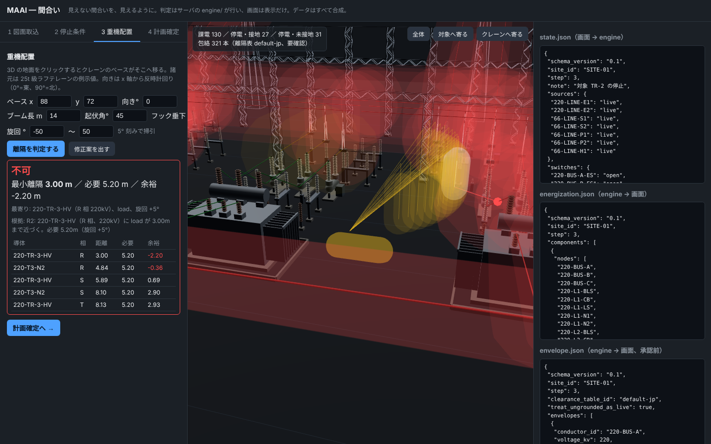
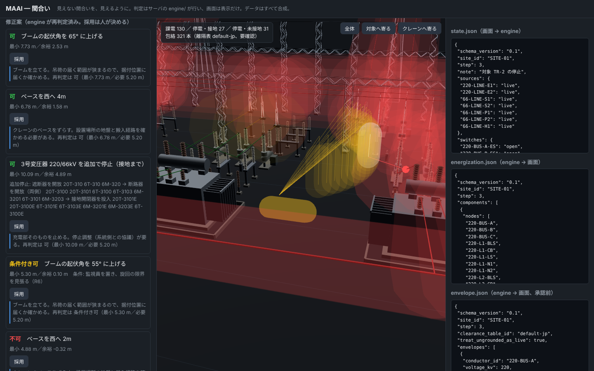

# MAAI（間合い）— Minimum Approach Area Indicator

**見えない間合いを、見えるように。**

変電所の機器を取り替えるとき、どこを止め、どこに接地し、残った充電部とクレーンの間にどれだけ距離が残るかを、図面から計算して描き出す机上の道具です。安全の判定は、同じ入力にいつも同じ答えを返す計算コード（決定論）が行います。Claude は図面の意味づけと説明だけを受け持ち、採否は人が決めます。

> このリポジトリのデータはすべて合成です。実在する事業者・変電所・図面・写真・人は含みません（[データについて](#データについて)）。


## 何を解くか

変電所の設備更新工事は、運転中の構内で行われます。取り替える機器の周りは止めますが、受電回線や母線は片側しか止められず、すぐ隣に電気の流れている導体が残ります。そこへクレーンが入ると、ブームや吊荷が充電部に近づく場所ができます。

近づいてはいけない距離は、図面のどこにも描かれていません。系統のつながりと開閉器の状態から計算して初めて分かり、停止の手順が一段進むたびに変わります。今は担当者が頭の中で図面を塗り分け、平面図に円を描いて確かめ、現地では見張る人の目に頼っています。人が減り、経験者が入れ替わると、この判断は再現できなくなります。

## 誰が使うか

取り替える機器を決め、停止計画を自分で組み、重機の配置を工事会社と詰める工事担当者。系統側との最終調整と承認は人が持ちます。この道具は、その人が頭の中でやっている「塗り分けて、間合いを測る」を、同じ順番で画面に出します。

## 流れ（画面の 4 タブ）

| | タブ | 何をするか | 誰が決めるか |
|---|---|---|---|
| 1 | 図面取込 | 単線結線図（ベクター PDF）を読み込む。線・開閉器記号・番号から接続を起こし、開閉器が「未確認」で並ぶ。種別の確認と質問文は Claude（呼べなければ規則） | 接続は決定論。確認は人 |
| 2 | 停止条件 | 取り替える機器を選ぶと、遮断器開放 → 断路器開放（両側）→ 接地開閉器投入 の停止ステップが出る。段階ごとに、どの導体が生きているかを判定し、3D に赤（課電）・緑（停電・接地）・黄（停電・未接地）で塗り分ける | 決定論 |
| 3 | 重機配置 | クレーンを置く（ベース・向き・ブーム長・起伏角・旋回範囲）。旋回の範囲を掃引して、ブーム・ロープ・吊荷と充電部の最小距離を出し、可／条件付き可／不可と根拠を返す。不可なら修正案（ベース移動・旋回制限・起伏・追加停止）を一つずつ再判定して並べる。説明文は Claude | 判定と候補は決定論。採用は人 |
| 4 | 計画確定 | 承認すると、もう一度判定し直してから `approved/` に plan・envelope・段階ごとに塗り分けた単線結線図 PDF を書き出す。不可は承認できない | 人 |






## 設計判断

- **安全の判断は計算で、説明は Claude で。** 課電判定・距離・包絡・停止ステップ・修正案の候補と再判定は `engine/` の決定論コードが行い、テストで固めます（`python -m pytest -q`）。Claude は数値を決めません。
- **Claude の出力は必ず engine が再検証してから表示し、採否は人が決める。** 取り込んだ図面の種別が規則と食い違えば、上書きせず「要確認」として人に戻します。
- **迷ったら保守側。** 停止したが接地していない区間は、既定では課電扱いで包絡を出します（画面で切替可。画面写真の黄色がそれです）。
- **カメラで充電部を当てない。** 生きているかどうかは見た目では分かりません。系統のつながりと開閉器の状態から計算します。
- **情報を外に出さない作り。** Claude を呼ぶのは `agent/client.py` の一か所。送る前に `agent/mask.py` が線路名・所名を符号に置き換え、送った内容を `logs/outbound/` に残します。容量・潮流・整定・暦日・座標はそもそもデータに持ちません。
- **キーが無くても全画面が動く。** 意味づけと説明は規則の代替に切り替わり、安全判定は何も変わりません。
- **数十年使えるデータに。** 入力は図面、出力は版番号つきの JSON と PDF。判断の数値（離隔表、余裕、監視員の条件）はコードでなくファイルに置きます（`data/tables/`, `data/rules/`）。

判断の経緯は [docs/decisions.md](docs/decisions.md)、Claude に任せること・任せないことの一覧は [docs/claude-boundary.md](docs/claude-boundary.md)。

## Claude に任せること・任せないこと

| 任せる（`agent/`） | 任せない（`engine/` と人） |
|---|---|
| 取り込んだ図面の意味づけ：開閉器の種別の確認、名前の無い導体の説明、人に確かめてほしい点の文章 | 図面からの接続の読み取り（線の太さ・交点・記号の位置で決まる） |
| 修正案の説明：何を変え、何が良くなり、何を犠牲にするか。順位づけの理由 | 課電判定、距離、包絡、停止ステップ、修正案の候補づくりと再判定 |
| | 承認 |

## 動かし方

```bash
pip install -r requirements.txt
python -m pytest -q
uvicorn server.app:app --reload     # http://localhost:8000
```

1. タブ 1 で `data/sites/SITE-01/drawings/SITE-01_sld.pdf` を選んで「取り込む」。「質問の無いものを確認済にする」。
2. タブ 2 で対象「2BK 2号変圧器」のまま「停止ステップを作る」→「段階 3」。3D の 2 号バンクだけ緑になる。
3. タブ 3 で「離隔を判定する」→ 不可（3 号変圧器の一次に 3.00 m、必要 5.20 m）。「修正案を出す」→ 「ブームの起伏角を 65° に上げる」を採用 → 可。
4. タブ 4 で「承認して書き出す」。`data/sites/SITE-01/approved/plan-*/` に `step-0..3-sld.pdf` ができる。

- **Claude を使うとき**: `.env.example` を `.env` にコピーして `MAAI_ANTHROPIC_API_KEY` を入れます。シェルの環境変数には入れないでください。
- **Claude を呼ばずに動かすとき**: `MAAI_OFFLINE=1`。キーが無いときも、意味づけと説明は規則に切り替わって全画面が動きます。
- **取込の精度を見るとき**: `python scripts/run_eval.py` が表で出します。

合成変電所と図面を作り直すには `python -m synth.gen_site && python -m synth.gen_drawings`。機器の寸法は `synth/equipment.py` の一か所で、図面と 3D が一緒に変わります。

## データについて

- 合成変電所 SITE-01 は、全屋外気中変電所の一般的な配置（220kV 単母線・66kV 1・1/2 母線・変圧器 3 バンク）を、公開されている標準の図面規格（JIS Z 8311、JIS C 0617）と公開カタログの代表寸法を参考に生成したものです。特定の事業者の規程・図面・製品の写しではありません。開閉器番号の規則も合成です。
- 離隔距離は厚生労働省「職場のあんぜんサイト」の目安値（低圧 1 m、高圧 1.2 m、特別高圧 2 m、60kV を超えると 10kV ごとに 0.2 m 増し）で、表に「要確認」と付けています（`data/tables/clearance.csv`）。実際の運用では各社の基準に従ってください。クレーン諸元は 25t 級ラフテレーンの例示値です。
- 図面取込はベクター PDF（線と文字が取り出せるもの）が対象で、スキャン画像の PDF は対象外です。

## この先

- 配置図の取込（結線図と同じ番号で結ぶ）。今は配置は合成の座標を使っています
- 作業指示の自然文から、止められない回線・作業対象・重機を取り出す
- 停止要否検討書の文章
- 承認済みの包絡を現地（AR）とクレーン側の装置へ
- 3 相架線の全造形、点群との照合、工程表との連携、設備台帳との接続

## ドキュメント

- [進み具合](STATUS.md) ／ [残りの作業](TASKS.md)
- [仕組みの図](docs/architecture.md) ／ [仕様書](docs/spec.md) ／ [設計判断の記録](docs/decisions.md) ／ [Claude に任せること・任せないこと](docs/claude-boundary.md)
- [開発環境の導入手順](docs/setup.md) ／ [動画の台本](docs/demo-plan.md)

## ライセンス

Apache License 2.0
