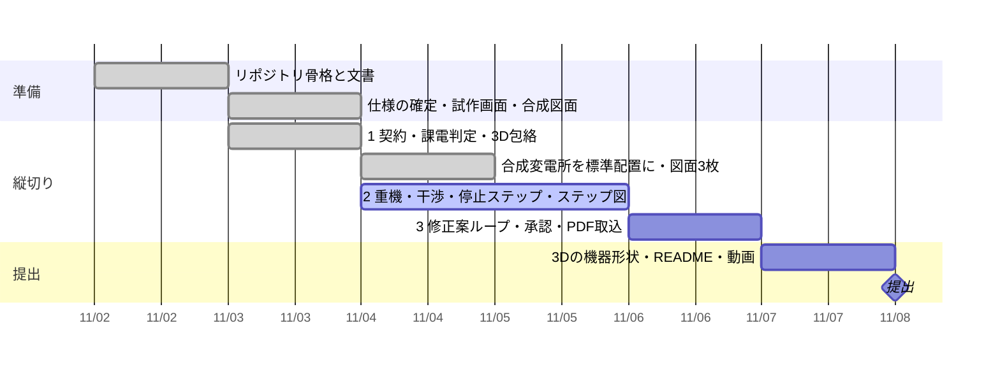

# 進み具合

更新: 2026-11-04 19:30

## 結論

提出物の線引きが決まり、合成変電所が標準配置になり、図面 3 枚が本物の流儀で出るようになった。次は縦切り 2（重機・干渉・停止ステップ自動生成・ステップ図）。

## 今日決めたこと

- **提出物**: 取り替える機器を選ぶ → 停止ステップが自動で出る → 3D で残る充電部とクレーンの離隔 → 可／条件付き可／不可と根拠、修正案 → ステップ図 → 人が承認。Claude は図面を読んで番号でつなぐ・修正案・説明文。判定は決定論、承認は人
- **合成変電所 SITE-01**: 全屋外気中の標準配置。135m×125m、北に 220kV 単母線（3 区間、線路 2・バンク 3）、中央に変圧器列と構内道路、南に 66kV 1・1/2（6 ダイヤ、調相 SC/SR、線路 5、D6 新設予定）、東に建屋。停止例 4 本（通常／2号 220 側のみ／2号両側／中央セクション B 停止）
- **機器の形**: `synth/equipment.py` に電圧階級ごとの寸法。220kV は母線直下のパンタ型断路器、2 柱の垂直一点切、タンク形 GCB（CT はブッシング根元）、腕つき引留鉄構、構外の鉄塔。66kV は二点切とタンク形
- **図面**: 単線結線図（JIS 記号、高圧右、電圧で線幅、番号は記号の右）、一般平面図 1/1000、機械器具装置図 A1（平面 1/400、断面 A-A 全体・B-B 220kV 線路ベイ・C-C 66kV ダイヤ）
- **開閉器番号**: 合成の規則 `20E1-110` `20T-2100E` `6S1-130` など。topology の `number`

## 確かめた結果

- `python -m pytest -q`: 24 件通過（契約 9、課電 11、包絡 4）。逆送 invalid、両側切離し、中央セクション停止で両端が運転継続、新設ダイヤ
- `python -m synth.gen_site` → truth（235 ノード・168 辺・235 項目）。`python -m synth.gen_drawings` → `data/sites/SITE-01/drawings/` に 3 枚
- `uvicorn server.app:app` → 3D 画面は新構成で動く（カメラは構内の広がりに自動で合う）。機器の形はまだ線だけ
- 公開前チェック OK（禁止語リストは未登録のまま）

## 判断してほしいこと

| # | 判断 | 選択肢 | 何が変わるか・費用・後戻り |
|---|---|---|---|
| 1 | 11/5 の順番 | A. 重機・干渉 → 停止ステップ自動生成 → ステップ図（推奨） ／ B. 停止ステップ自動生成を先に | A: 見せ場「不可が可に変わる」が先に動く。B: 社内で効く「ステップ図が出直る」が先。どちらも 11/5 中に両方へ届く見込み。後戻りは無い |
| 2 | PDF 図面取込の範囲 | A. 結線図＋配置図（番号で結ぶ） ／ B. 結線図だけ（推奨は A、11/6 夜に遅れていれば B） | A は Claude の見せ場が強い。B は半日短い。11/6 夜に決めてよい |

## 次の一手

1. 縦切り 2 前半（今夜〜11/5 午前）: `engine/geometry.py`（線分間距離）→ `engine/crane.py`（ブーム・フック・旋回掃引）→ `engine/clearance.py`（最小距離、可／条件付き可／不可、R6 監視員）。テストつき
2. 縦切り 2 後半（11/5）: 画面で重機を置く。停止ステップ自動生成 `engine/steps.py`。ステップ図の塗り分け PDF
3. 本人: `.forbidden-terms.local.txt`、離隔値の公開出典

## 引き継ぎ（この時点で知っておくこと）

- 機器の寸法を変えるときは `synth/equipment.py` だけ。図面と 3D の座標が一緒に変わる
- 図面の描き方の流儀は一般的なもの（JIS Z 8311・C 0617）で説明できる範囲に限る。特定の事業者の規程・資料は出典も原文も入れない
- 変圧器ベイは線路ベイから 8m 東（パンタ型の柱が重ならないように）。X1〜X3 はバンク、線路は X=40/96
- 母線側断路器 `*-BLS` の `at` は母線中心。相ごとの柱は (x+idx·相間, y−idx·相間)
