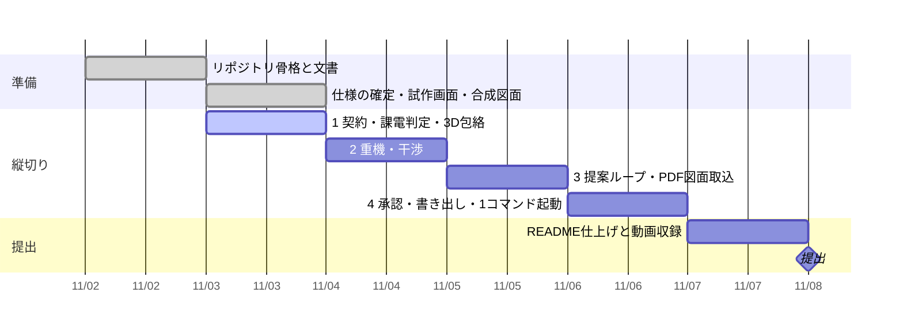

# 進み具合

更新: 2026-11-03 08:50

## 結論

一部完了。朝の手順（批評・タスク更新）は済み、縦切り1 の着手待ち。本番に残るコード（`engine/` `contracts/`）はまだ無い。

## 確かめた結果

- 初回の外部批評 `docs/critique/1103.md`: 10/20（切実さ 3、伝わり方 3、Claude の役割 2、作り込み 2）。最重要は「本番に残るコードがゼロ」
- 課電判定の試作: `python -m pytest proto/tests -q` 7件通過（前回と同じ）
- 批評で見つけた公開上の食い違い: `proto/FREEZE.md` と `docs/claude-boundary.md` が 11/3 の決定と逆（言葉で語る方式・DXF 読取の扱い）。直す作業は `TASKS.md` に積んだ
- 禁止語リスト `.forbidden-terms.local.txt` はまだ空。これまでの push 17件は禁止語の検査なし

## 判断してほしいこと

| # | 判断 | 選択肢 | 何が変わるか・費用・後戻り |
|---|---|---|---|
| 1 | 今日の一つに着手してよいか | A. やって（推奨） ／ B. 先に公開の食い違い（FREEZE・boundary・語の除去）を直す | A: 契約3本 → `engine/energize.py` + テスト7件 → `proto/` の該当部を削除。2〜3時間。後戻り可（git）。B: 1.5時間、作り込みは進まない |
| 2 | この会話からの push 経路 | A. GitHub で書き込み付きの接続を許可する（推奨） ／ B. 差分ファイルを受け取り本人が取り込む | 今の接続は読み取りのみ。A: 以後コミットと push をこちらで行える。B: 毎回 patch の受け渡しが要り、フック（公開前チェック）が本人側でしか走らない |
| 3 | `agent/tools.py` の MCP サーバ化 | A. 未採用で閉じる（推奨） ／ B. 11/6 夜に再判断 | A: §16 の行を Known に移すだけ、費用ゼロ。動くものが無い今は決める材料がなく、閉じても後で足せる |

## 次の一手

1. 判断 1〜3 を番号で回答。1 が A なら、契約（スキーマ）→ テスト → エンジンの順で進め、§15 縦切り1 の手元確認の手順を出して止まる
2. 図面の描き方のルール 6 点（記号、機器番号の付け方、配置の流儀、文字の置き方、高さの書き方、表題欄）。実物は貼らない
3. クレーン 2〜3 機種の仮定値（ブーム長・作業半径・最大揚程）と、困り具合の概数（予防停止の件数、1件の調整時間）

## 引き継ぎ（この時点で知っておくこと）

- 試作画面は課電・離隔を画面内で計算している。本番では `engine/` に移し、画面は右側の JSON（§6 の形）を `server/` に送って結果を受け取るだけにする
- `proto/` は契約が違う試作。ロジックとテストを §6 の契約に移植したら消す
- `web/vendor/three/` は three.js r160（MIT）。`python scripts/build_prototype.py` が HTML に埋め込む
- 本人のパソコンはこちらからコマンドを打てない。ファイルの受け渡しは GitHub 経由
- 合成図面は「教科書の記号」で描いた暫定版。描き方のルールをもらってから生成器を書き直す（縦切り3 の直前でよい）
