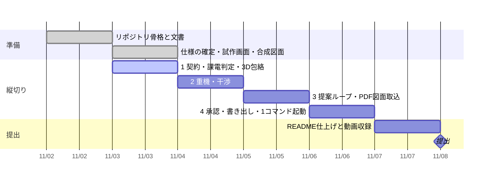

# 進み具合

更新: 2026-11-03 11:20

## 結論

縦切り1 完了（手元確認待ち）。契約・課電判定・合成変電所・安全包絡・サーバ・3D 画面が一続きで動く。判断はすべて `engine/`、画面は表示だけ。

## 確かめた結果

- `python -m pytest -q`: 23 件通過（課電判定 10、契約・生成器 9、包絡 4）。逆送で `invalid`、1・1/2 母線の運転継続、新設ベイ付近の充電導体は母線だけ、の 3 場面を含む
- `python -m synth.gen_site` → `data/sites/SITE-01/truth/` に topology（252 ノード・176 辺）、layout（254 項目）、状態 3 本（通常／2号変圧器 220kV 側のみ停止／両側停止）。すべて `contracts/` の契約に合格
- `uvicorn server.app:app` → http://localhost:8000 を headless Chrome で通し: 状態 3 本の切替、開閉器のチェックで再判定、JS エラー 0（favicon の 404 のみ）。画面 `docs/img/step2-tr2-outage.png`
- 包絡: 220kV 5.2 m・66kV 2.2 m（目安値、要確認）。未接地の停止区間も既定で包絡を作る（保守側、画面で切替可）
- `proto/` の課電判定部分（src・tests・schema）は削除。図面生成（`proto/tools/`）は `synth/` へ移すまで残す
- 公開前チェック: OK（禁止語リストは未登録のまま）
- 初回の外部批評 `docs/critique/1103.md`: 10/20。最重要「本番に残るコードがゼロ」は、この縦切りで解消に向かう

## 判断してほしいこと

| # | 判断 | 選択肢 | 何が変わるか・費用・後戻り |
|---|---|---|---|
| 1 | この会話からの push 経路 | A. GitHub で書き込み付きの接続を許可する（推奨） ／ B. 差分ファイルを受け取り本人が取り込む | 今の接続は読み取りのみ。ローカルに 2 コミット溜まっている。A: 以後こちらで push できる。B: 毎回 patch の受け渡し |
| 2 | §15 縦切り1 の手元確認の場面 | A. 「2号変圧器の停止」に差し替える（推奨） ／ B. 旧 SITE-01（66kV 単母線・B回線）のまま | §15 は旧 SITE-01 前提。A: 通常で全導体が赤、両側停止で変圧器まわりが緑、220kV 側だけ停止で赤＋警告。仕様の 1 行を直すだけ |

## 次の一手

1. 手元確認（縦切り1）: `git pull` → `pip install -r requirements.txt` → `python -m pytest -q` が `23 passed` → `uvicorn server.app:app` → http://localhost:8000 → タブ「2 停止条件」。「normal」で導体が全部赤、「tr2-outage」で 2号変圧器まわり（D2 南側）が緑、「tr2-outage-220-only」で紫＋警告、包絡が半透明の赤で見えれば合格
2. 縦切り2（11/4）: 幾何（線分間距離・5 ケース）→ クレーン包絡 → 干渉判定 → 画面で赤線と最小距離。クレーン仮定値が届けばそれを、届かなければ例示値で
3. 図面の描き方のルール 6 点、クレーン仮定値、困り具合の概数（前回と同じ待ち）

## 引き継ぎ（この時点で知っておくこと）

- 契約の端子の約束（開閉器は a・b、変圧器は hv・lv、開閉器 open なら両側が別成分）は `docs/decisions.md` 11/3 と `contracts/topology.schema.json` の description に書いた
- `state.json` に書かれていない機器は保守側（開閉器 closed・接地 open・電源 live）
- 合成サイトの線路名は方面名・番号（東線1L、北線1L、港線1L…）に改めた。`proto/data/drawings/` の PDF は旧名のまま（図面生成を移すときに作り直す）
- 本人のパソコンはこちらからコマンドを打てない。ファイルの受け渡しは GitHub 経由
