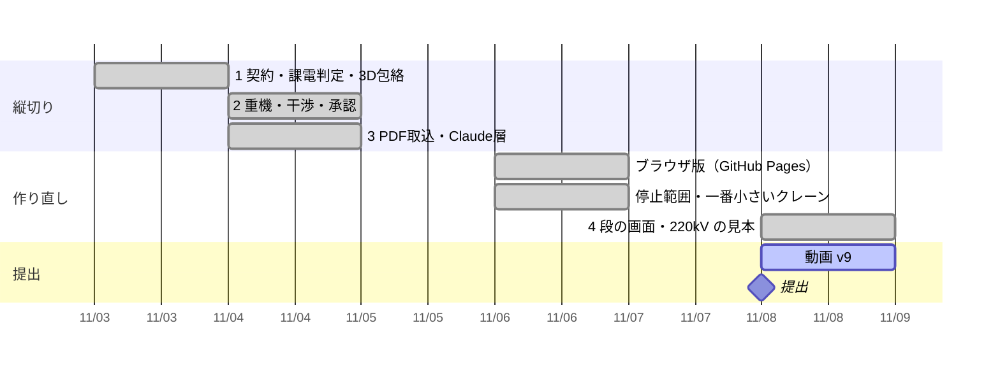

# 進み具合

更新: 2026-11-08 17:02

## 結論

動画 v9（2 分 58 秒、読み上げは VOICEVOX:WhiteCUL）を、本人の指摘（50 代の数字、名前を置き換える理由、クレーンの級の比べ、止まったときの影響）を入れて書き出した。アプリは「停止なしでは作業できない」をはっきり出すように直し、公開ページも新しい版になった（一部完了: 動画の URL と提出が残る）。

## 確かめた結果

- テスト 107 件すべて合格。通しの確認 7/7 合格。公開前チェック OK（269 ファイル）
- 公開ページ（GitHub Pages、ブラウザだけで動く版）は main の新しい版で作り直し済み（GitHub Actions の pages・check とも成功）
- 公開前の点検係（読み取りだけのサブエージェント）が今日の差分 89 ファイルを点検し、重大な問題なし
- 見本（220kV 東線1L の遮断器、重さ 10 t の例示値）: 重さと届く距離だけなら 25t 級。25t〜70t 級は母線に 2.6〜5.4 m まで近づいて使えず（必要 7.00 m）、100t 級なら 8.08 m で置ける。母線は止められない条件なので 100t 級
- 外の目の点検で見つかった不具合（「質問の無いものを確認済に」が、質問の文に出てくる開閉器まで確認済にしていた）を直した
- 別のアカウントの初見の点検（画面だけを見て触る）で、Claude につながらない公開版が止められない母線を止める案を出すと分かり、決まった書き方の条件は規則で読むように直した。どの級でも離隔を保てないときは「停止なしでは作業できない」と、何を止めれば何級でできるかを先頭に出す

## 判断してほしいこと

| # | 判断 | 選択肢 | 何が変わるか・費用・後戻り |
|---|---|---|---|
| 1 | 動画の URL を README に入れて main に push | はい（推奨）／いいえ | README の「すぐ見る」から動画へ行ける。費用なし。後で戻せる |

## 次の一手

1. 動画を見て YouTube に限定公開（URL を知る人だけ）で上げ、URL を返す
2. 提出フォームの下書き v5 で提出する
3. 次の段階: 条件の文の欄をやめ、結線図・設備台帳・納入仕様書・平面図で入れて 3D で確かめる形にする（README の「この先」）
