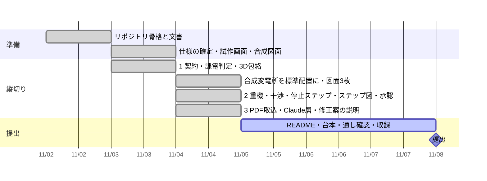

# 進み具合

更新: 2026-11-04 20:15

## 結論

縦切り 1〜3 がすべて `main` に入り、取込 → 停止ステップ → 離隔 → 修正案 → 承認・PDF まで通しで動く（テスト 44 件）。残りは README・台本・収録と、本人の手元確認。ここからは Claude Code CLI で進める。

## 今日できたこと（11/4）

- **縦切り 2**: 線分間距離 → クレーン包絡（旋回掃引）→ 可／条件付き可／不可と根拠（R1/R2/R6）→ 修正案の候補（移動・旋回制限・起伏・追加停止、全部 engine が再判定）→ 承認（不可は拒否、承認ハッシュ、`approved/` に plan/envelope/step-0..3 の塗り分け PDF）
- **縦切り 3**: ベクター PDF の単線結線図を投げ込むと、線と記号と番号から topology の下書き（合成図面で 開閉器番号 136/142、隣接 precision 1.0 / recall 0.953、質問 9）。Claude 層 `agent/`（client・mask・structure・explain）。キー無しでも全画面が規則で動く
- **画面**: 4 タブ（取込・停止条件・重機配置・計画確定）、3D は `equipment.py` の寸法で機器の形、視点ボタン、クレーンの初期値は「段階 3 で不可 → 起伏角 65° で可」になる位置
- 画面写真 `docs/img/ui-1..4-*.png`、判断の記録 `docs/decisions.md`、境界 `docs/claude-boundary.md`

## 確かめた結果

- `python -m pytest -q` → 44 passed。`python scripts/public_safety_check.py --all` → OK（100 ファイル。禁止語リストは未登録）
- `uvicorn server.app:app` → 取込（PDF 選択 → 取り込む → 質問の無いものを確認済に）→ 2BK を対象に停止ステップ → 段階 3 → 離隔判定「不可」→ 修正案 → 採用「可」→ 承認 → `approved/plan-*/` に PDF 7 枚
- Claude を実際に呼ぶ経路（`.env` にキー）は**未確認**（この環境にキーが無い）。規則の代替経路だけ確認済み

## 判断してほしいこと

| # | 判断 | 選択肢 | 何が変わるか・費用・後戻り |
|---|---|---|---|
| 1 | 動画の見せ場の順 | A. 図面取込から始めて承認で終わる（流れどおり、推奨） ／ B. 「不可 → 可」を冒頭に出してから流れ | A は分かりやすい。B は最初の 30 秒が強い。台本を書き分けるだけで後戻りできる |
| 2 | クレーンの 3D | A. 今のカプセル表示のまま（推奨） ／ B. CC-BY の GLB を探して載せる | B は 1〜2 時間と出典の管理が増える。判定には関係しない |

## 次の一手（Claude Code CLI で。順番どおり）

1. 本人: `.env` に `MAAI_ANTHROPIC_API_KEY` を入れて `uvicorn` を起動し、取込タブの右上が「Claude: claude-…」になり、取込の「意味づけ: Claude」と修正案の「説明: Claude」が出ることを確かめる。出なければ `logs/outbound/` の request/response を見る
2. CLI: `/daily` → README を書く（問題 → 使う人 → 流れ 4 タブ → 設計判断 → Claude に任せること・任せないこと → 合成データと制約 → 動かし方 → この先）。画面写真は `docs/img/ui-*.png`。`docs/claude-boundary.md` と `docs/decisions.md` から引く。「審査」「評価基準」「ハッカソン向け」は使わない
3. CLI: `docs/demo-plan.md` を 3 分の秒割りに書き直す（0:00 一言 → 0:20 取込 → 0:50 停止ステップで電気が消える → 1:20 不可 → 1:50 修正案と Claude の説明 → 2:20 承認と PDF → 2:40 仕組みとこの先）
4. 本人: `.forbidden-terms.local.txt` を書いて `python scripts/public_safety_check.py --all`。離隔値の公開出典を `data/tables/clearance.csv` に
5. 11/7 収録、11/8 午前に通し確認 → 提出

## 引き継ぎ（この時点で知っておくこと）

- 起動: `pip install -r requirements.txt` → `uvicorn server.app:app --reload` → http://localhost:8000。取込に使う PDF は `data/sites/SITE-01/drawings/SITE-01_sld.pdf`
- Claude を呼ぶのは `agent/client.py` だけ。`agent/mask.py` で線路名・所名を符号化し、`logs/outbound/` に request/response を残す。`MAAI_OFFLINE=1` で呼ばない
- Claude が返すのは「種別の確認・質問文」（structure）と「修正案の説明」（explain）だけ。種別が規則と食い違っても上書きせず質問にする
- 取込の精度は `python scripts/run_eval.py` が表で出す。見つからない 6 番号は D6（未設、破線）のもので仕様どおり
- 承認の出力は `data/sites/SITE-01/approved/`（git 管理外）
- 機器の寸法を変えるときは `synth/equipment.py` だけ。図面と 3D が一緒に変わる
