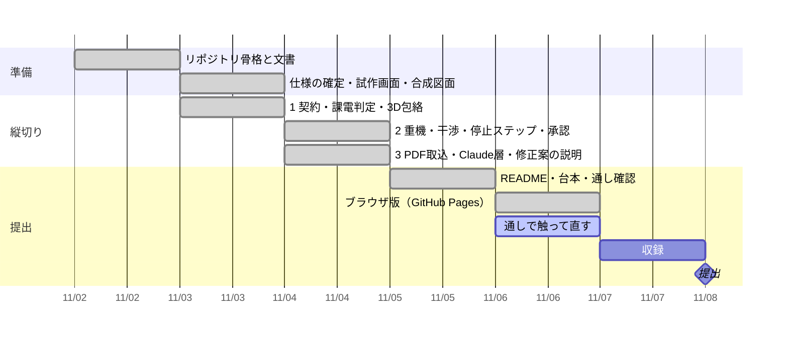

# 進み具合

更新: 2026-11-06 07:25

## 結論

ブラウザ版を公開した。https://daxion1578.github.io/Minimum-Approach-Area-Indicator/ を開くだけで、サーバ無しで 4 タブが最後まで動く。状態: 完了（本人も表示を確認済み）。

## 確かめた結果

- テスト 57 件すべて合格（ブラウザ版がサーバ版と同じ答えを返すテスト 2 件を追加）。公開前チェック OK、通しの確認 6/6 合格
- 公開 URL を自動操作のブラウザで通した: 準備 約 5 秒 → 図面取込 136/142、precision 1 / recall 0.953 → 停止ステップ「接地まで通った」→ 離隔「不可」（3.00 m／必要 7.00 m）→ 修正案の採用で「可」→ 承認で PDF 4 枚が開く
- 中身: ブラウザの中で Python を動かす仕組み（Pyodide）で、サーバ版のコードをそのまま実行。Claude は呼ばない（ブラウザに API キーを置けないため）
- 手元のサーバ版（収録で使う画面）は変わっていないことを確認
- 未確認: AR 試作のページ（`/web/ar.html`）が公開サイトで開くか。作り方の上では残してある

## 判断してほしいこと

| # | 判断 | 選択肢 | 何が変わるか・費用・後戻り |
|---|---|---|---|
| 1 | 動画にブラウザ版を入れるか | A. 最後の 5 秒で URL を映す（推奨） ／ B. 入れない | A は「誰でもすぐ触れる」が伝わる。台本に 1 行足すだけで後戻りできる |

## 次の一手

1. 本人: https://daxion1578.github.io/Minimum-Approach-Area-Indicator/web/ar.html が開くか見る（開かなければ番号で知らせる）
2. 本人: `.forbidden-terms.local.txt`（公開しない語のリスト）を書いて `python scripts/public_safety_check.py --all`
3. 今日は通しで触って直す（機能追加はしない）。明日 11/7 に収録
