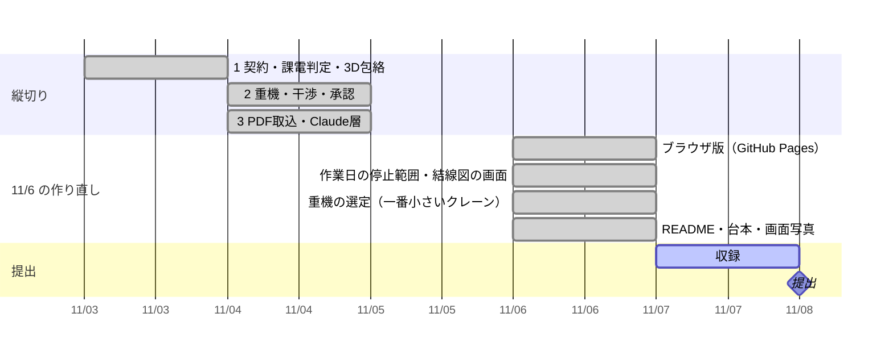

# 進み具合

更新: 2026-11-08 00:30

## 結論

話し合ったゴールまで作り終えた（完了）。停止は作業日の停止範囲になり、単線結線図の上で追える。重機は吊る 2 点と重さから一番小さいクレーンを計算で選び、追加で止めれば何級で済むかも出る。サーバ版とブラウザ版の両方で通しで動く。

## 確かめた結果

- テスト 67 件すべて合格。公開前チェック OK。通しの確認 7/7 合格（GitHub Actions も同じものを回す）
- 見本（66kV 遮断器 6T-110 の作業日）: 切る機器 3（6T-110・6T-1101・6T-1103）→ 重さだけなら 10t 級、離隔のために 35t 級（一つ下は 1 号変圧器の 66kV 側に 2.60 m、必要 4.00 m で使えない）→ 1 号変圧器を追加で止めれば 20t 級 → 採用で「条件付き可」（4.02 m／必要 4.00 m、監視員）→ 承認で停止範囲図 PDF 3 枚
- 自動操作のブラウザで、サーバ版とブラウザ版の両方を最後まで通した（承認ハッシュまで一致）
- カメラ AR の実験ページは公開サイトから外した（AR の試作 `web/ar.html` は残した）

## 11/8 未明にやったこと（Claude Code）

- **工事の依頼文を Claude が読む**（批評 1107 の「今日やるべき一つ」）: 依頼文から取り替える機器・止められない設備・資材置場・重さを取り出し、engine が番号の実在と矛盾を確かめ、人が「この内容で入れる」。「1 号バンクは止められない」と書けば追加停止の案は出ず 35t 級（止められるなら 25t 級、の参考つき）。依頼文の一言で計算の答えが変わる
- **図面の意味づけの不具合を直した**: Claude をつなぐと 5 分かかって出力の上限で切れ、規則に戻っていた。食い違いだけ返させて 20 秒に。待つ間もサーバが応える
- **動画を完成**（語り v5 = 本人の v4 ＋ 3 つの直し ＋ 依頼文の場面）: Claude をつないだサーバ版を自動で撮影。送る前の置き換えは実際の送信記録（東線 1L・2L → LINE-1・LINE-2）を映す。構想映像の計画も本編と同じ 35t 級に作り直した。3 分ちょうど
- テスト 89 件すべて合格、通しの確認 7/7、公開前チェック OK

## 判断してほしいこと

| # | 判断 | 選択肢 | 何が変わるか・費用・後戻り |
|---|---|---|---|
| 1 | 公開ブランチ `judge-review`（「審査員レビュー…」というコミット）と `lab-camera-ar` を消すか | A. `judge-review` だけ消す（推奨） ／ B. 両方消す ／ C. 残す | 作品の文章に「審査」を持ち込まない約束に触れる。消すと元に戻せない（手元に残してから消せる）。5 分 |
| 2 | `proto/` のデータにある「Opus 線」「Mythos 線」という名前 | A. ほかの合成の名前に置き換える（推奨） ／ B. 残す | 実在の名前ではないが、モデル名に見える。置き換えは 10 分、後戻りできる |

## 次の一手

1. 本人: 動画 `F:\Dev\MAAI-video\maai-demo.mp4`（字幕入り、3:00）を見て確かめる。字幕なし版 `maai-demo-nosub.mp4` と字幕 `narration.srt` もある。直したい所があれば言う（撮り直しは約 15 分）
2. 本人: `.forbidden-terms.local.txt`（公開しない語のリスト）を書いて `python scripts/public_safety_check.py --all`（まだ空）
3. 本人: 動画を上げ、README「すぐ見る」に URL を 1 行足して push → 提出フォーム（締切 11/8 20:00、17:00 目標）。文章はチャットの `claude/submission-text-1107.md`
