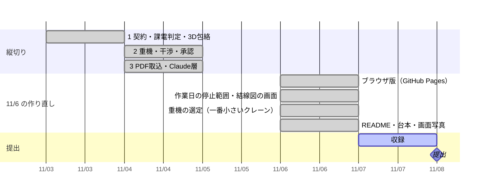
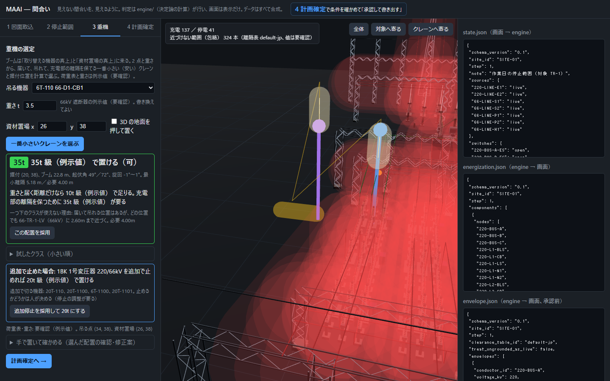

# 進み具合

更新: 2026-11-07 16:00（11/7 はチャット側から文章と提出準備だけ。コードは変えていない）

## 結論

話し合ったゴールまで作り終えた（完了）。停止は作業日の停止範囲になり、単線結線図の上で追える。重機は吊る 2 点と重さから一番小さいクレーンを計算で選び、追加で止めれば何級で済むかも出る。サーバ版とブラウザ版の両方で通しで動く。

## 確かめた結果

- テスト 67 件すべて合格。公開前チェック OK。通しの確認 7/7 合格（GitHub Actions も同じものを回す）
- 見本（66kV 遮断器 6T-110 の作業日）: 切る機器 3（6T-110・6T-1101・6T-1103）→ 重さだけなら 10t 級、離隔のために 35t 級（一つ下は 1 号変圧器の 66kV 側に 2.60 m、必要 4.00 m で使えない）→ 1 号変圧器を追加で止めれば 20t 級 → 採用で「条件付き可」（4.02 m／必要 4.00 m、監視員）→ 承認で停止範囲図 PDF 3 枚
- 自動操作のブラウザで、サーバ版とブラウザ版の両方を最後まで通した（承認ハッシュまで一致）
- カメラ AR の実験ページは公開サイトから外した（AR の試作 `web/ar.html` は残した）

## 判断してほしいこと

なし（判断 #1 は B に決定: 変圧器を取り替えるときは専用ベイを母線の手前まで止める。11/6 に反映、テスト 65 件）

## 11/7 にチャット側でやったこと

- README に「なぜ今か」（一次資料つきの数字 4 つ: 変圧器約 15,000 台を約 220 台/年、変電作業員の 50 代以上約 5 割、感電死傷の重大事故 35 件、事例集の蓋の取り違え）と「どう作ったか（Claude Code）」の節、three.js・Pyodide の謝辞を足した。`docs/spec.md`・`proto/FREEZE.md`・`docs/claude-boundary.md` の公開向けでない語を直した（c28c693）
- 公開状態を確認: リポジトリは Public・Apache-2.0、最初のコミットは 11/2 22:18、Actions（check・pages）は成功、`.env`・`*.local.*`・実図面形式の追跡なし
- 提出フォーム用の文章（一行紹介・概要 2 種・動画の説明欄・よく聞かれる項目）をチャットのプロジェクトに保存（`claude/submission-text-1107.md`）
- 収録用の札 2 枚をチャットで渡した。構想映像（30 秒、`ar-concept.mp4`）も描画してチャットで渡す。台本の語りは合計 785 字／180 秒（4.4 字/秒）で収まる。速いのは冒頭 0:00–0:20（6.3 字/秒）と締め 2:50–3:00（6.7 字/秒）。締めは構想映像を 25 秒で止めて 15 秒に伸ばすと読める

## 次の一手

1. 本人: `.forbidden-terms.local.txt`（公開しない語のリスト）を書いて `python scripts/public_safety_check.py --all`。11/7 時点でも未記入
2. 本人: 収録は `.env` のキーを入れたサーバ版で（取込タブ右上が「Claude: claude-sonnet-5-5」になる）。Claude の出力が画面に出る唯一の機会なので、規則の代替で撮らない
3. 本人: 動画を上げたら README「すぐ見る」に URL を 1 行足して push → 提出フォーム（締切 11/8 20:00、17:00 目標）。文章は `claude/submission-text-1107.md`
