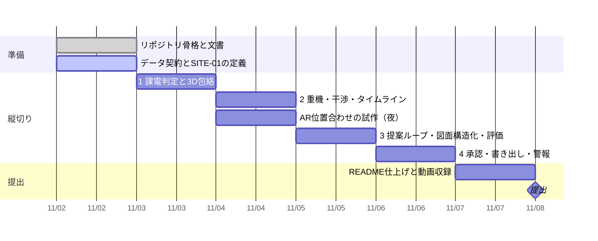

# 進み具合

更新: 2026-11-02 23:55

## 結論

一部完了。リポジトリの骨格（文書・Claude Code の設定・公開前チェック）ができた。データ契約とサイト定義はこれから。

## 確かめた結果

- 公開前チェック: 全ファイル OK（禁止語リストは各自の手元で設定）
- フックの模擬テスト: 禁止語・APIキー・緯度経度の検出、`--no-verify` の拒否、テスト失敗時の差し戻しがすべて期待どおり
- エンジンのテスト: まだ無い

## 判断してほしいこと

まず仕様の芯（本人の回答待ち。詳細は `docs/spec.md` §1・§3・§16）

- 使う人と場面: 工事会社の相談を受けて確認する側でよいか
- 停止範囲が最初に届く形: 設備単位の文面／操作の一覧／色塗りの図
- 一番もめる・手戻りする問い: クレーン据付／吊り荷／搬入経路／仮置き／撤去品
- 困り具合の数字: 1件の確認時間、件数、判断に迷う頻度

技術の判断（11/3 中）

| 論点 | 選択肢 | 理由 | 影響 |
|---|---|---|---|
| MCP の採用 | **推奨** 課電判定ができた時点でエンジンを MCP サーバとしても公開 | 開発中の Claude Code とアプリの提案ループが同じ道具を使える。審査の「機能の使い分け」に直結 | 半日 |
| | 採用しない | 作業が減る | 審査の説明が弱くなる |
| 完成の定義の追加 | **推奨** 「1コマンド起動・サンプル即表示・キー無しで全画面」を加える | 審査の「安心してそのまま使える」 | 11/6 に1〜2時間 |

期限: 11/3 中。

## 次の一手

1. 新しいアカウントで clone し、`docs/setup.md` の手順で環境を作る
2. `docs/setup.md` §7 の指示で、データ契約と SITE-01 の定義を作る
