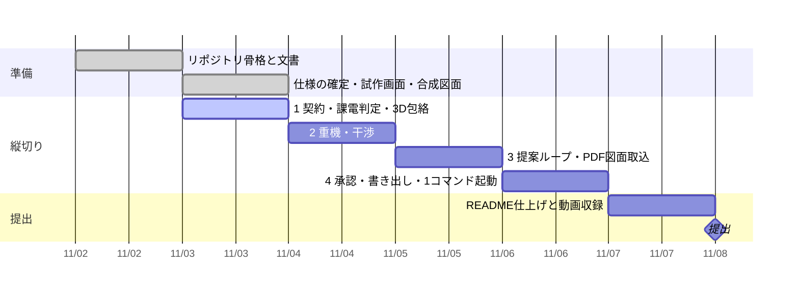

# 進み具合

更新: 2026-11-03 08:15

## 結論

一部完了。仕様の芯は確定し、動く試作画面と合成図面がある。`engine/` はまだ空。次は縦切り1（契約→課電判定の移植）。

## 確かめた結果

- 試作画面 `web/prototype.html`（単体ファイル、ダブルクリックで開く）: headless Chromium で file:// から4ステップを通してエラー 0
- 課電判定の試作: `python -m pytest proto/tests -q` 7件通過（変圧器逆送の FAULT、1・1/2 の運転継続、新設ベイ付近の充電導体）
- 合成図面 3 枚（`proto/data/drawings/`）: ベクター PDF、文字が取り出せることを確認
- 公開前チェック: 全ファイル OK（禁止語リストは未登録。最初の push 前に `.forbidden-terms.local.txt` を書く）
- 外部批評: まだ一度も実行していない（`/daily` で初回）

## 判断してほしいこと

なし。11/3 に決めたこと（すべて `docs/decisions.md`）:
契約は仕様§6 ／ 合成サイトは 220/66kV 1・1/2 ／ 使う人は「停止計画も組む工事担当」／ 入力は PDF 図面の投げ込み（縦切り3 に前倒し）／ 範囲は §4 の順で末尾から切る ／ 作品の文章に評価の語彙を使わない。

## 次の一手

1. Claude Code で `git pull` → `/daily`（批評 → `TASKS.md` 更新 → 今日の一つ＝契約を §6 で書き `proto/` の課電判定を `engine/` に移植、の提案で止まる）→「やって」
2. 図面の描き方のルール 6 点（記号、機器番号の付け方、配置の流儀、文字の置き方、高さの書き方、表題欄）を Claude に伝える。実物は貼らない。これが揃うと合成図面を実務の流儀に書き直せる（縦切り3 の前提）
3. クレーン 2〜3 機種の仮定値（ブーム長・作業半径・最大揚程）を伝える（縦切り2 の前提。今は例示値）

## 引き継ぎ（この時点で知っておくこと）

- 試作画面は課電・離隔を画面内で計算している。本番では `engine/` に移し、画面は右側に表示している JSON（§6 の形）を `server/` に送って結果を受け取るだけにする
- `proto/` は契約が違う試作。ロジックとテストを §6 の契約に移植したら消す
- `web/vendor/three/` は three.js r160（MIT）。ビルド `python scripts/build_prototype.py` が HTML に埋め込む（file:// ではローカル module の import が拒否されるため）
- 本人のパソコンはこちらからコマンドを打てない（仮想化が無効）。ファイルの受け渡しは GitHub 経由
- 合成図面は「教科書の記号」で描いた暫定版。本人から「実務の単線図はこの表記ではない」との指摘あり。描き方のルールをもらってから生成器を書き直す
