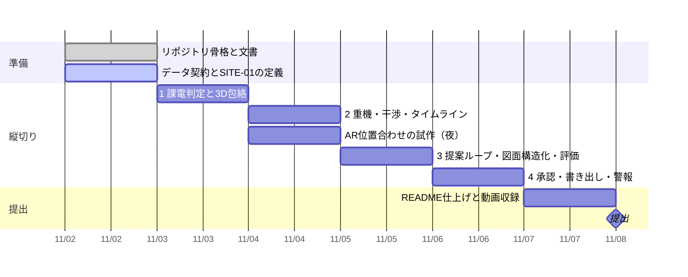

# 進み具合

更新: 2026-11-03 05:20

## 結論

一部完了。リポジトリの骨格（文書・Claude Code の設定・公開前チェック）ができた。データ契約とサイト定義はこれから。

## 確かめた結果

- 公開前チェック: 全ファイル OK（禁止語リストは各自の手元で設定）
- フックの模擬テスト: 禁止語・APIキー・緯度経度の検出、`--no-verify` の拒否、テスト失敗時の差し戻しがすべて期待どおり
- エンジンのテスト: まだ無い

## 判断してほしいこと

なし（11/3 05:20 時点）。契約は仕様§6、合成サイトは 220/66kV 1・1/2、範囲は §4 の順に進めて末尾から切る、で決定済み（`docs/decisions.md`）。

## 次の一手

1. Claude Code で `git pull` してから `/daily` を打つ（批評 → `TASKS.md` 更新 → 今日の一つの提案、で止まる）
2. 夜は `/wrap`
