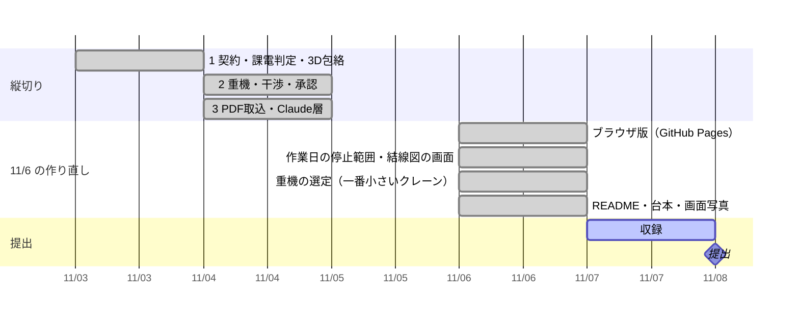

# 進み具合

更新: 2026-11-06 08:50

## 結論

話し合ったゴールまで作り終えた（完了）。停止は作業日の停止範囲になり、単線結線図の上で追える。重機は吊る 2 点と重さから一番小さいクレーンを計算で選び、追加で止めれば何級で済むかも出る。サーバ版とブラウザ版の両方で通しで動く。

## 確かめた結果

- テスト 64 件すべて合格。公開前チェック OK。通しの確認 7/7 合格（GitHub Actions も同じものを回す）
- 見本（66kV 遮断器 6T-110 の作業日）: 切る機器 3（6T-110・6T-1101・6T-1103）→ 選定 50t 級（一つ下は 1 号変圧器の 66kV 側に 2.60 m、必要 4.00 m で使えない）→ 1 号変圧器を追加で止めれば 25t 級 → 採用で「可」（4.74 m／必要 4.00 m）→ 承認で停止範囲図 PDF 3 枚
- 自動操作のブラウザで、サーバ版とブラウザ版の両方を最後まで通した（承認ハッシュまで一致）
- カメラ AR の実験ページは公開サイトから外した（AR の試作 `web/ar.html` は残した）

## 判断してほしいこと

| # | 判断 | 選択肢 | 何が変わるか・費用・後戻り |
|---|---|---|---|
| 1 | 変圧器を取り替えるとき、ベイの遮断器と母線側断路器も切るか | A. 今のまま（隣の断路器だけ切る。遮断器側は充電で、離隔の判定は厳しめ）推奨 ／ B. ベイ全体を切る | B は決まりに 1 行足すだけ（30 分）。実務がどちらかで決まる。後戻りできる |

## 次の一手

1. 本人: 公式の案内で締切（11/8 20:00 か 11/10 14:00 か）を確かめる。`.forbidden-terms.local.txt`（公開しない語のリスト）を書いて `python scripts/public_safety_check.py --all`
2. 本人: ブラウザ版 https://daxion1578.github.io/Minimum-Approach-Area-Indicator/ を開き、上の帯の案内どおりに 4 タブを押してみる（台本 `docs/demo-plan.md` と同じ流れ）
3. 11/7 収録。言い回しで直したい所があれば CLI に言う
