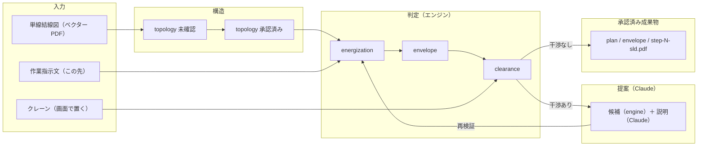
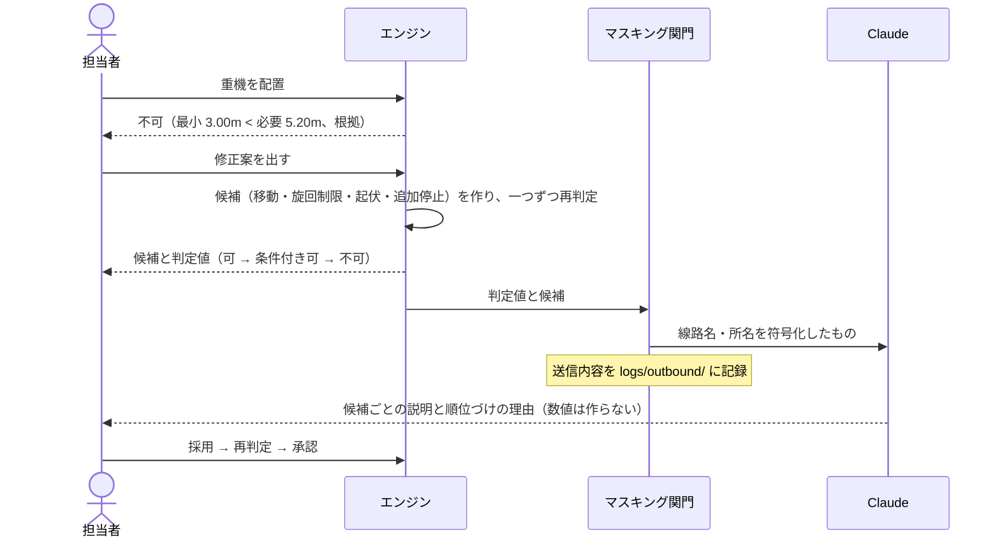

# 仕組みの図

時間軸が二つある。処理の順番（取込→判定→提案→承認）と、停止ステップの進行（0→3）。この文書は前者を描く。後者はアプリの画面（ステップのスライダー）で見せる。

## データの系譜

左から右へ処理が進む。矢印は「どのデータから作られたか」。図面が正で、JSON はすべて派生物。

## 修正案の流れ（11/4 時点の実装）

上から下へ時間が流れる。候補を作って再判定するのはエンジン、Claude は説明だけ。Claude への送信は必ずマスキング関門を通る。

